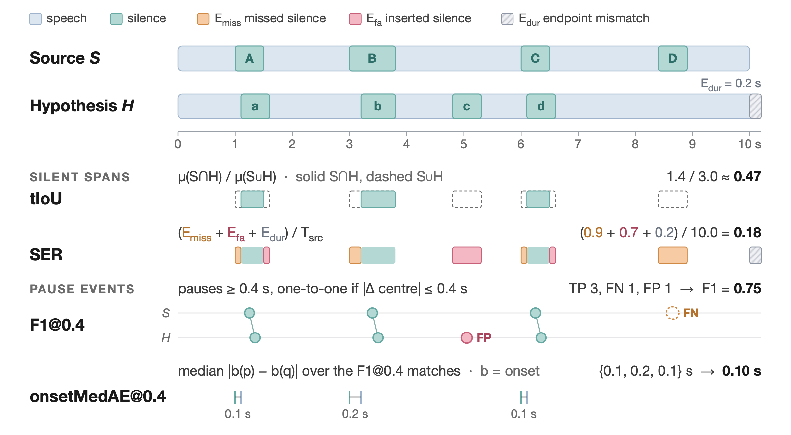

# TransDubber: Learning Timeline-Preserving Speech-to-Speech Translation

[](https://arxiv.org/abs/2611.00690) [](https://zhishengzheng.com/transdubber/) [](https://huggingface.co/zhisheng01/TransDubber) [](#environment) [](LICENSE)

**TL;DR:** TransDubber translates English speech into Chinese speech while preserving timing,
pauses, and speaker voice. This repository provides training, inference, and evaluation code.

## Environment

Use Python 3.11 and CUDA-capable GPUs. Run the following commands from the repository root:

```bash
python3.11 -m venv .venv
source .venv/bin/activate
pip install torch==2.8.0 torchaudio==2.8.0 --index-url https://download.pytorch.org/whl/cu128
pip install -r requirements.txt
```

Stage 4 requires FlashAttention. It is also the default attention backend for inference:

```bash
pip install flash-attn==2.8.3.post1 --no-build-isolation
```

For inference without FlashAttention, set `attn_impl=sdpa`.

## Models and paths

Download the assets needed for your task:

| Asset | Used for |
|---|---|
| [Qwen3-ASR-1.7B](https://huggingface.co/Qwen/Qwen3-ASR-1.7B) | Training and inference |
| [Fun-CosyVoice3-0.5B](https://huggingface.co/FunAudioLLM/Fun-CosyVoice3-0.5B) | Inference; needs `flow.pt`, `hift.pt`, `campplus.onnx`, and `speech_tokenizer_v3.onnx` |
| [MetricX-24](https://huggingface.co/google/metricx-24-hybrid-xxl-v2p6-bfloat16) | Stage 4 and MetricX evaluation |

Set the local paths you need:

```bash
export base_model=/path/to/Qwen3-ASR-1.7B
export token2wav_root=/path/to/Fun-CosyVoice3-0.5B
export metricx_root=/path/to/metricx-model
export data_root=/path/to/data
export ckpt_root=/path/to/checkpoints
```

For Stage 4 or MetricX evaluation, also clone the MetricX source:

```bash
git clone https://github.com/google-research/metricx "${metricx_root}/metricx"
```

Training data and trained TransDubber checkpoints are not included in this repository.

## Training

Prepare Parquet inputs and update the `dataset.*_parquet_dir` lists in [config/](config/).
Each entry can be a file or a directory of Parquet shards; the supplied paths are placeholders.
The dataset classes in [dataset/speech_dataset.py](dataset/speech_dataset.py) define the schemas:

| Input | Main columns |
|---|---|
| Stage 1 ASR | `en_path`, `en_length`, `pause_text` with pause markers prepared offline |
| Stage 1 text translation | `en_path`, `en_length`, `en_text`, `zh_text` |
| Stage 2–3 speech translation | `en_path`, `en_length`, `en_text`, `zh_text`, `zh_codes` (binary `uint16` codec IDs), `zh_length` |
| Stage 4 RL, single-audio rows | `en_path`, `en_length`, `text`; optional `zh_text` reference and `vad` intervals |

Stage 3 paired-pause rows also require `target_pause_spans_s` (`start_s`/`end_s` pairs),
`rendered_num_samples`, and `sample_rate`. Multi-audio rows use list-valued source/text columns
and `silence_length` for SFT; target codes cover the combined target audio.

Run the stages in order. Set `NUM_GPUS` to the number of GPUs to use; Stage 4 needs at least two
(one reward-server process and one or more training processes).

```bash
export NUM_GPUS=2
export WANDB_MODE=offline

# Stage 1: ASR and text translation
torchrun --standalone --nproc_per_node="$NUM_GPUS" main.py --config-name s2s-stage1-asr-ast

# Stage 2: speech generation
torchrun --standalone --nproc_per_node="$NUM_GPUS" main.py --config-name s2s-stage2-speech

# Stage 3: timeline-preserving SFT
torchrun --standalone --nproc_per_node="$NUM_GPUS" main.py --config-name s2s-stage3-iso-full

# Stage 4: GSPO
torchrun --standalone --nproc_per_node="$NUM_GPUS" gspo_train.py --config-name gspo_stage4_rl
```

SFT checkpoints are saved under `$ckpt_root/sft/transdubber-stage{1,2,3}/checkpoints/`.
Each subsequent stage initializes from the previous stage's `last.ckpt` by default.
Stage 4 writes checkpoints to `$ckpt_root/rl/transdubber-stage4/checkpoints/`.
If you change its initialization checkpoint, update both `checkpoint.resume_ckpt_path` and
`checkpoint.required_init_checkpoint` to the same path.

Adjust batch size, learning rate, and other settings in the configs or with Hydra overrides,
such as `dataset.batch_size=1`. Reusing an output directory resumes saved training state.

## Inference

Provide a trained TransDubber SFT `.ckpt` or GSPO `.pt` checkpoint and one or more English audio files:

```bash
bash inference/infer.sh /path/to/checkpoint.pt outputs/inference /path/to/english.wav
```

Outputs in `outputs/inference/`:

- `audio/<name>.wav`: generated Chinese speech at 24 kHz.
- `translated_texts.txt`: `name<TAB>translation`.
- `predictions.jsonl`: transcripts, translations, generation metadata, and status.

Use distinct input file stems. For decoding options, run:

```bash
python inference/infer_single.py --help
```

## Evaluation

Use the inference output directory. Source audio must be available as `<source_dir>/<name>.wav`,
with names matching the inference outputs. Text metrics require a headerless TSV manifest with
three tab-separated columns: `name`, `source_transcript`, and `reference_translation`.

```bash
OUT=outputs/inference
SRC=/path/to/source_audio
REF=/path/to/manifest.tsv

# MetricX reference-based and QE scores; requires the MetricX assets above
GT_PATH="$REF" python eval/metricx.py "$OUT/translated_texts.txt"

# Duration matching
python eval/duration_metrics.py --root "$OUT" --source-audio-dir "$SRC" \
    --output-json "$OUT/duration_metrics.json"

# Pause alignment and timeline metrics: F1@0.4, tIoU, SER, onsetMedAE@0.4
python eval/timeline_metrics.py --root "$OUT" --source-audio-dir "$SRC"
```

The four pause/timeline metrics are illustrated below (click the figure for the PDF):

[](assets/pause-metrics.pdf)

| Metric | Measures | Output key |
|---|---|---|
| F1@0.4 ↑ | Pause-event F1 with one-to-one midpoint matching within 0.4 s | `f1_at_04` |
| tIoU ↑ | Intersection over union of source and generated silence durations | `tiou` |
| SER ↓ | Missed silence, inserted silence, and endpoint mismatch, normalized by source duration | `ser` |
| onsetMedAE@0.4 ↓ | Median absolute onset error in seconds over the F1@0.4 matched pauses | `onset_mae_at_04` |

These keys appear under `all_pauseful` in `timeline_metrics.json` and in `timeline_per_sample.tsv`.
The `isometric10_pauseful` summary additionally restricts outputs to within 10% of the source duration.
For onsetMedAE, the summary averages per-utterance medians over utterances with matched pauses.

Summaries and per-sample scores are written alongside the inference outputs; BLEU prints its
aggregate score to stdout. Additional silence-overlap metrics are available through
`python eval/silence_iou.py --root "$OUT" --source-audio-dir "$SRC"`.

## License

This work is licensed under the [Apache License 2.0](LICENSE).

**Copyright (c) 2026 Zhisheng Zheng / The University of Texas at Austin.**

## Citation

If you use this work in your research, please cite:

```bibtex
@article{transdubber2026,
  title   = {Learning Timeline-Preserving Speech-to-Speech Translation},
  author  = {Zheng, Zhisheng and Harwath, David},
  journal = {arXiv preprint arXiv:2611.00690},
  year    = {2026}
}
```
